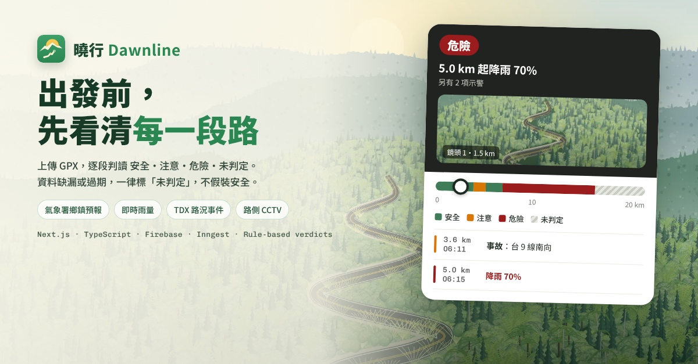
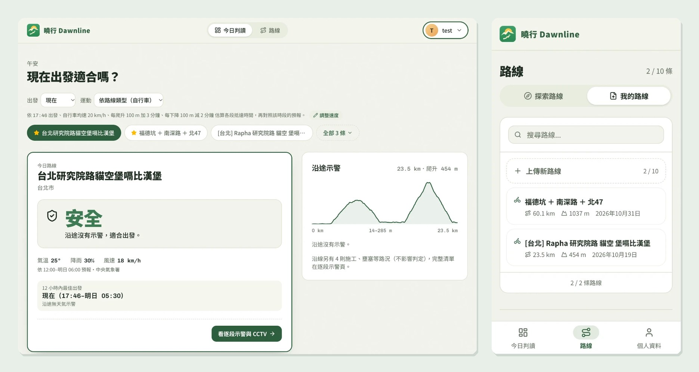
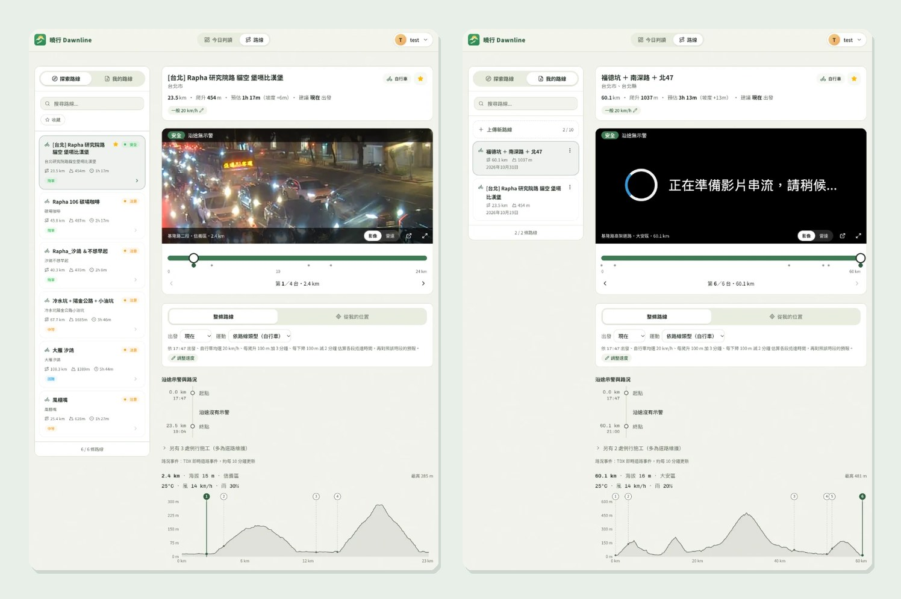
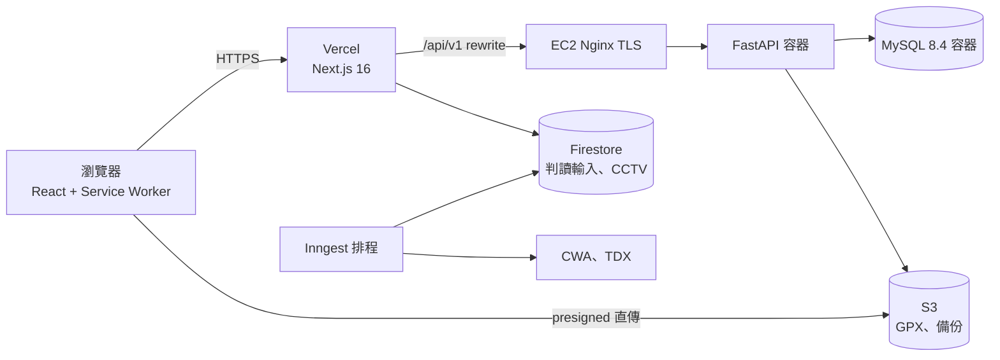

# 曉行 Dawnline

[](https://github.com/muchuanhung/dawnline/actions/workflows/ci.yml)
[](https://github.com/muchuanhung/dawnline/actions/workflows/backend-ci.yml)
[](https://github.com/muchuanhung/dawnline/actions/workflows/backend-deploy.yml)
[](https://github.com/muchuanhung/dawnline/actions/workflows/backend-monitor.yml)

> 騎車、跑步、健行出發前，上傳 GPX，逐段標出「安全／注意／危險／未判定」。

**線上網址：** <https://dawnline-tw.vercel.app>

曉行沿 GPX 軌跡每 0.5 km 取樣反查鄉鎮，依每一段的預估抵達時間（含爬升與下坡修正）挑出氣象署鄉鎮預報的時段，再疊上 3 km 內的測站即時雨量、未來 1 小時雷達降雨預報與 TDX 路況事件，給每一段一個判定，並在路線上顯示沿線 CCTV。

**未判定 ≠ 安全。** 資料缺漏、預報過期、抵達時間超出預報時段、離線快照超過 30 分鐘，一律判為未判定並說明原因。判定只用規則式邏輯，不經過 LLM。

## 畫面



*左：今日判讀，登入後切換列是收藏＋自己上傳的路線，判讀在伺服器算好再送出。右：手機版「我的路線」，顯示上傳配額 2／10。*



*路線偵察：沿線 CCTV／雷達、鏡頭在路線上的里程、示警時間軸與高程圖。左為公開路線，右為自己上傳的私人路線。*

## 主要功能

| 頁面 | 說明 |
|---|---|
| `/` 首頁 | 精選公開路線的即時判定；已登入轉今日判讀 |
| `/dashboard` 今日判讀 | 未登入也能看。目前路線的判定、示警時間軸、建議出發時段；登入後切換列是「我的路線」（收藏＋自己上傳），可拖曳排序並跨裝置同步 |
| `/routes` 探索 | 公開路線清單（搜尋、類型、收藏篩選）＋路線偵察：CCTV／雷達回放、4 色路況條、高程圖、途中模式（GPS 換算里程，只判讀前方） |
| `/routes/private` 我的路線 | 上傳私人 GPX（進度條、每人 10 條）、改名、刪除；詳情與公開路線同一套偵察畫面 |
| `/profile` 個人資料 | 頭像上傳、登出 |
| 管理員 | 在探索頁上傳、覆寫、下架公開路線 |
| PWA | 可安裝到主畫面；看過的路線離線也打得開，過期的「安全」自動降為未判定 |

## 架構



完整說明見 [雲端系統架構](docs/cloud-architecture.md)。

| 範疇 | 實際使用 | 為什麼 |
|---|---|---|
| 前端 | Next.js 16（App Router、Server Components、Route Handlers）、React 19、TypeScript、Tailwind CSS v4、shadcn/ui、framer-motion | 判讀在伺服器算好再送 HTML，手機不必等第二次請求 |
| 後端 | FastAPI、SQLAlchemy 2、Alembic、MySQL 8.4 | 使用者資料需要權限、配額與外鍵 |
| 認證 | Firebase Authentication；Next.js 與 FastAPI 各換一份 HttpOnly session | 不重寫登入，後端只驗 ID token |
| 儲存 | S3（GPX、頭像、每日 DB 備份）、Firestore（判讀輸入、CCTV 清單） | 原始 GPX 保留可重算；短命的外部資料放無伺服器資料庫 |
| 排程 | Inngest（判讀輸入每 10 分鐘、CCTV 每日） | TDX 限流嚴，統一由排程抓 |
| 雲端 | Vercel（東京）＋ AWS EC2 東京、ECR、SSM、S3 | 單機＋容器，不用 ALB、RDS（成本） |
| 部署 | GitHub Actions：OIDC → ECR → SSM，健康檢查失敗自動回滾 | 沒有長期金鑰，部署不經過 SSH |
| 外部資料 | 氣象署 F-D0047 鄉鎮預報、O-A0002-001 雨量站、F-B0046-001 雷達降雨預報；TDX 路況事件、CCTV | — |
| 地理運算 | 內建台灣鄉鎮 TopoJSON point-in-polygon、polyline 垂足投影 | 不依賴付費地圖 API |
| 測試 | Playwright（unit＋E2E 桌機／手機）、pytest、ruff；CI 另跑真實 MySQL | — |

## 文件

| 文件 | 內容 |
|---|---|
| [資料表關係（ERD）](docs/erd.md) | 8 張表、外鍵、索引、設計決定 |
| [雲端系統架構](docs/cloud-architecture.md) | 每條連線的協定與認證、Security Group、部署與監控、技術選擇理由 |
| [前端架構與狀態](docs/frontend-architecture.md) | 組件樹、狀態放在哪裡、Context 與 Custom Hooks 的用法 |
| [資料管線（ETL／ELT）](docs/data-pipeline.md) | 判讀輸入、CCTV、雷達、GPX、備份五條管線 |
| [技術重點](docs/tech-highlight.md) | 離線 PWA 與「安全會過期」、地理運算 |
| [資料庫索引調校](backend/docs/db-tuning.md) | 6 萬條路線假資料下的 EXPLAIN 前後對照 |
| [AWS 部署紀錄](backend/docs/deploy-aws.md) | EC2、Nginx、MySQL、S3、IAM、備份的重建步驟 |
| [降雨信心規則](strava-route-system/apps/web/docs/rain-confidence.md) | 降雨機率高但雨勢小時的降級規則與門檻依據 |

## 專案結構

```
backend/                      # FastAPI（部署到 EC2）
├── app/{routers,services,models,schemas}/
├── alembic/versions/         # migration 0001–0009，只加不刪
├── deploy/                   # deploy.sh、nginx.conf、備份腳本、IAM 範本
├── docs/
└── tests/                    # pytest
strava-route-system/          # pnpm + Turborepo
└── apps/web/                 # Next.js（部署到 Vercel）
    ├── src/app/              # 頁面與 /api Route Handlers
    ├── src/components/
    ├── src/hooks/            # Custom Hooks
    ├── src/contexts/         # AuthContext
    ├── src/lib/              # cwb、tdx、routes、dashboard（判讀規則為純函式）
    ├── src/inngest/          # 排程
    ├── public/sw.js          # Service Worker
    └── tests/{unit,e2e}/
docs/                         # 期末報告文件
.github/workflows/            # ci、backend-ci、backend-deploy、backend-monitor
```

## 本機開發

### 前端

需求：Node 22（`strava-route-system/.nvmrc`）、pnpm 9。

```bash
cd strava-route-system
pnpm install
pnpm --filter web dev                       # http://localhost:3000
npx inngest-cli@latest dev -u http://localhost:3000/api/inngest   # 需要排程時另開終端
```

`strava-route-system/apps/web/.env.local`：

```bash
# Firebase（必填）
NEXT_PUBLIC_FIREBASE_API_KEY=
NEXT_PUBLIC_FIREBASE_AUTH_DOMAIN=
NEXT_PUBLIC_FIREBASE_PROJECT_ID=
NEXT_PUBLIC_FIREBASE_STORAGE_BUCKET=
NEXT_PUBLIC_FIREBASE_MESSAGING_SENDER_ID=
NEXT_PUBLIC_FIREBASE_APP_ID=
FIREBASE_SERVICE_ACCOUNT_JSON=              # service account JSON 字串

# FastAPI 後端（公開路線、私人路線、收藏都從這裡讀）
BACKEND_API_URL=http://localhost:8000

# 天氣與路況（缺任一項時相關路段判為未判定；缺 TDX 時也沒有 CCTV）
CWB_API_KEY=
TDX_CLIENT_ID=
TDX_CLIENT_SECRET=

# 其他
NEXT_PUBLIC_APP_URL=http://localhost:3000
CCTV_SYNC_SECRET=                           # production 手動觸發 /api/cctv/sync
ALERT_WEBHOOK_URL=                          # Discord webhook，選填
# 正式環境的 Inngest 另需 INNGEST_EVENT_KEY、INNGEST_SIGNING_KEY
```

### 後端

```bash
cd backend
cp .env.example .env
docker compose up -d mysql                  # 本機 MySQL 8.4
pip install -e ".[dev]"
alembic upgrade head
uvicorn app.main:app --reload               # http://localhost:8000
```

詳見 [`backend/README.md`](backend/README.md)。

## 測試

```bash
# 前端
cd strava-route-system/apps/web
pnpm test:unit            # 純函式，數秒內完成（CI 執行）
pnpm exec tsc --noEmit
pnpm lint
pnpm test:e2e             # 先 next build 再於 3100 port 啟動

# 後端
cd backend
pytest && ruff check . && ruff format --check .
```

登入後的 E2E 需要在 `.env.local` 設定 `E2E_USER_EMAIL`／`E2E_USER_PASSWORD`，未設定時自動跳過。

## 開發方式

主要使用 Claude Code 協作開發，規則寫在 [`AGENTS.md`](AGENTS.md)：判讀規則必須是純函式並有測試、測試沒過不准改測試硬湊、一律開 draft PR 由本人審查合併。`.githooks/` 擋下錯誤的 commit 身分與 AI 署名。

## 專案團隊

| 開發人員 | 負責範圍 |
|---|---|
| MuChuan Hung（[@muchuanhung](https://github.com/muchuanhung)） | 產品、全端開發、雲端部署 |
