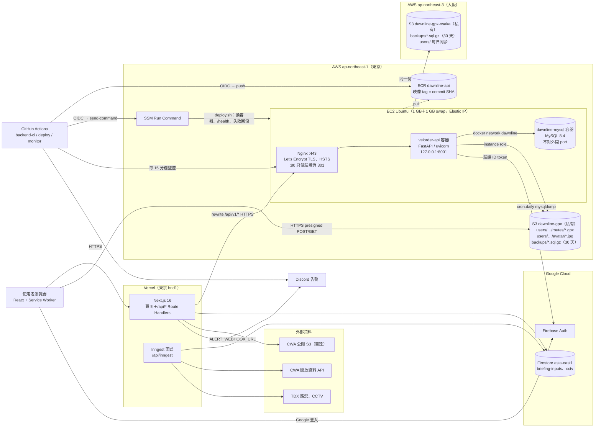
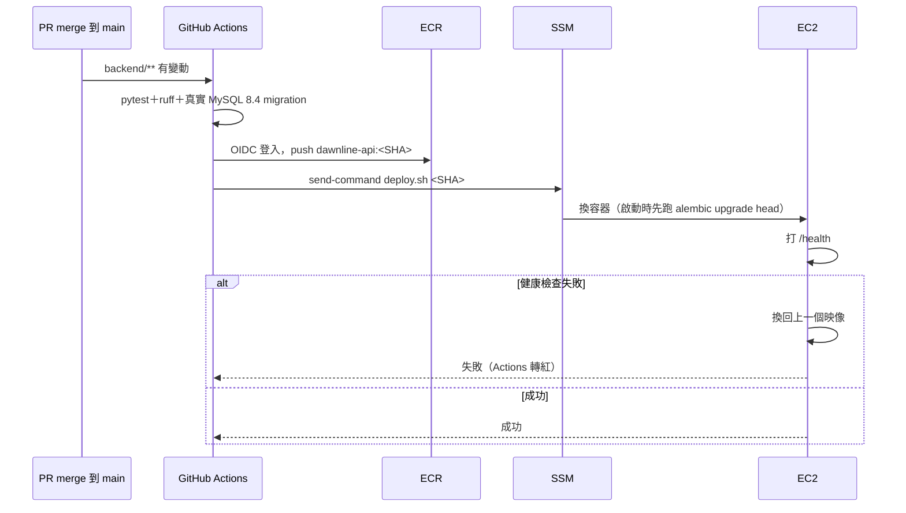

# D2 雲端系統架構

> 依 `backend/docs/deploy-aws.md`、`backend/deploy/`、`.github/workflows/` 與 `next.config.js` 實際設定整理（T5b 異地備份完成後定稿，2026-11-07；11/9 依 main `c22ad2a` 補上 #95 上傳暫存區、#97 OIDC 限 production、#102 Nginx 限流）。
> 重建步驟與每一條指令在 [`backend/docs/deploy-aws.md`](../backend/docs/deploy-aws.md)，這份只說明架構與理由。

## 結論

- **前端留在 Vercel**，**後端在 AWS 東京一台 EC2**：Nginx 終止 TLS，FastAPI 與 MySQL 各跑一個 Docker 容器，GPX 與備份放 S3。
- 瀏覽器只連兩個地方：Vercel（頁面與 `/api/*`）和 S3（presigned 直傳 GPX）。FastAPI 由 Vercel rewrite `/api/v1/*` 轉過去，所以登入 cookie 是 Vercel 網域上的同站 cookie。
- 對外只開 80、443；8000、8001、3306 只綁 127.0.0.1 或 Docker 內網。
- **資料每天異地備份到大阪**：DB 備份與使用者上傳的檔案，連東京整區出事都救得回來；機器本身不備份，照文件重建。
- 部署與監控全在 GitHub Actions：OIDC 換暫時憑證、SSM 下指令，**repo 與 Actions 都沒有長期 AWS 金鑰，也不需要 SSH**。

## 架構圖

## 每條連線

| 從 → 到 | 協定／port | 認證 |
|---|---|---|
| 瀏覽器 → Vercel | HTTPS 443 | Next.js session cookie（Firebase，5 天）＋ FastAPI `rc_session`（HttpOnly） |
| 瀏覽器 → S3 | HTTPS 443 | presigned POST／GET，5 分鐘有效，限檔案大小，key 由後端決定；上傳先進暫存區 `tmp-uploads/`（1 天 lifecycle），驗證通過才搬到 `users/` |
| Vercel → Nginx | HTTPS 443（`dawnline-api.message-board.bid`） | 轉發使用者的 cookie；Nginx 依使用者 IP（`X-Forwarded-For`）限流，目前 dry-run 只記錄（#102） |
| Nginx → FastAPI | HTTP 127.0.0.1:8001 → 容器 :8000 | 只在本機，uvicorn `--proxy-headers` |
| FastAPI → MySQL | TCP 3306，Docker 內網 `dawnline` | 帳號密碼在 `/opt/velorder/api.env`（不進 repo） |
| FastAPI → S3 | HTTPS | EC2 instance role（metadata hop limit 2，容器內才拿得到） |
| GitHub Actions → AWS | HTTPS | OIDC → IAM role `dawnline-gha-deploy`，只限本 repo 的 main 與 `production` environment（#97） |
| EC2 → ECR | HTTPS | instance role `AmazonEC2ContainerRegistryReadOnly` |
| EC2 → S3 大阪 | HTTPS | instance role，只能寫入與讀取，**沒有刪除權限** |

## Security Group

| Port | 來源 | 用途 |
|---|---|---|
| 80 | 0.0.0.0/0 | Let's Encrypt HTTP-01 驗證；其他請求 301 到 443 |
| 443 | 0.0.0.0/0 | HTTPS |
| 22 | 只限自己的 IP | 手動維護備用；部署不需要 |

**8000、8001、3306 不在 Security Group 裡。** 主機上 API 只綁 `127.0.0.1:8001`，MySQL 不發布 port。

## 部署與監控

| 工作 | 頻率 | 內容 |
|---|---|---|
| `backend-ci.yml` | 每個 PR | pytest、ruff、真實 MySQL 跑 migration 與 EXPLAIN 報告（T7） |
| `backend-deploy.yml` | merge 到 main | 如上圖；migration 只加不刪，回滾不必退 schema |
| `backend-monitor.yml` | 每 15 分鐘 | `/health`、TLS 憑證剩不到 14 天、主機資源、東京與大阪的 `backups/` 超過 26 小時或小於 1 KB |
| `backend-monitor.yml` 還原測試 | 每週一 07:40 UTC | 把大阪的最新備份還原到暫時的 MySQL 驗證 |
| AWS Budgets | 每月 | 月預算 US$1，達 85%、100% 或預測超過時寄信 |
| 前端 `ci.yml` | 每個 PR | `tsc --noEmit`＋單元測試；Vercel 另產生預覽網址 |

## 技術選擇的理由

| 決定 | 理由 | 放棄的選項 |
|---|---|---|
| 前端留 Vercel，後端搬 AWS | 前端已經穩定上線，Next.js 在 Vercel 零設定；課程重點是後端雲端架構 | 前端也搬 AWS（Amplify／CloudFront）：多花時間但報告沒有加分 |
| 單台 EC2＋Docker，不用 ECS／ALB | 使用者少、預算有限；ALB 一個月的固定費用比 EC2 本身還貴 | ECS Fargate、ALB：架構漂亮但成本與設定量不成比例 |
| MySQL 跑在同一台 EC2 容器，不用 RDS | 10/19 估算 RDS micro 每月約 15–18 美元，是帳單最大一項；資料量小，每日備份＋每週還原測試補足可靠度 | RDS：自動備份、維運省事，但成本比 EC2 本身還高 |
| Nginx＋Let's Encrypt 終止 TLS | 免費、自動續期（`/etc/cron.weekly/dawnline-certbot`），與同機另一個網站共用 | ACM：只能掛在 ALB／CloudFront 上 |
| ECR＋SSM 部署 | 映像 tag 用 commit SHA，回滾就是換回上一個 tag；SSM 不需要開 SSH、不需要金鑰 | SSH＋`git pull`：要在 Actions 放私鑰，主機上還要能 build |
| 異地備份只備資料，由備份腳本每天複製到大阪 | S3 本身跨 3 個可用區，扛得住單一資料中心故障；再複製到大阪，連東京整區出事都救得回來。機器設定都在 repo 與文件裡，可以重建 | S3 跨區複製（CRR）：要開版本控制，舊版本累積費用；EBS 跨區快照：每月約 NT$30–60，救的是可以重建的東西 |
| 監控用 GitHub Actions 排程 | 不用另外付費或架服務，結果與部署紀錄在同一個地方 | CloudWatch Alarms：需要另外裝 agent 才看得到記憶體與磁碟 |
| 判讀輸入存 Firestore，使用者資料存 MySQL | 判讀管線跑在 Vercel，只活 15 分鐘、不需要關聯；路線、收藏需要權限、配額與外鍵（見 [D1](erd.md)、[D5](data-pipeline.md)） | 全部放 MySQL：Vercel 每次都要跨網路連到 EC2 |

## 已知限制與未完成事項

- **單點**：EC2 掛掉時 API 停止；前端公開頁仍可看，已看過的路線有離線快照（見 [D7](tech-highlight.md)）。
- **記憶體**：1 GB（實際可用 909 MB）＋1 GB swap 上同時跑 Nginx、另一個網站、API、MySQL。11/7 實測（`free -m`、`docker stats`）：記憶體已用 528 MB、可用 381 MB，swap 已用 576 MB；`velorder-api` 容器 152 MiB、`dawnline-mysql` 容器 41 MiB，其餘是 Nginx、另一個網站與系統。swap 長期用掉一半以上，是升級規格前最先會撞到的限制。
- **異地備份的範圍**：只有 MySQL 備份與 `users/`。東京整區出事時，要在別的區域照 `deploy-aws.md` 重建主機、重新申請憑證，再從大阪還原；這段期間 API 停止。
- **刪除不會同步到大阪**：EC2 沒有大阪的刪除權限（防止誤刪或入侵時連異地一起刪掉），使用者在東京刪掉的檔案大阪會留著，要手動清。
- **憑證私鑰**：只在主機 `/etc/letsencrypt`（`700 root`，私鑰 `600`），不進 repo、不進備份；重建時重新申請。
- **限流仍是 dry-run**：Nginx `limit_req` 已上線但只記錄不擋（#102）。瀏覽器經 Vercel 轉發的請求帶得到使用者 IP；Next.js 伺服器端自己打後端的請求沒有帶，會共用 Vercel IP 的額度，正式開啟前要先讓伺服器端轉發使用者 IP。
- 沒有 IaC：所有設定以 `deploy-aws.md` 文字紀錄，主機與 repo 不一致時以主機為準再補回 repo。
