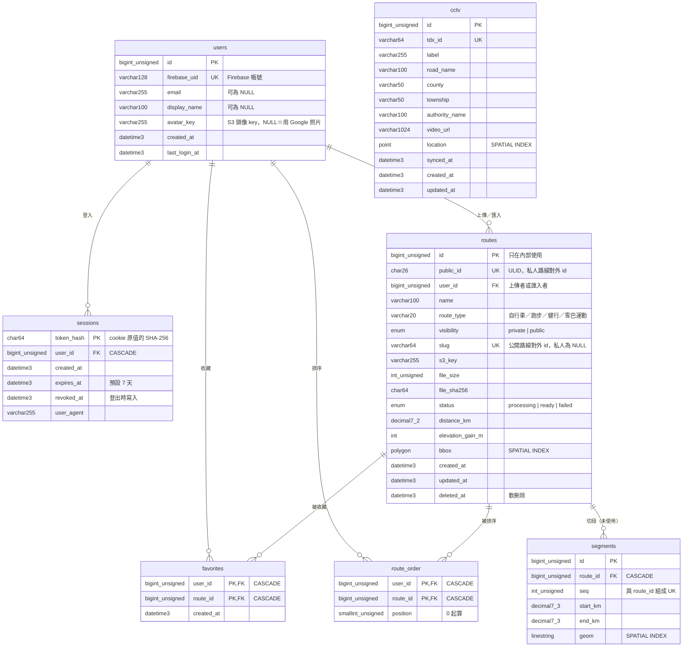

# D1 資料表關係結構（ERD）

> 依 `backend/app/models/*.py` 與 `backend/alembic/versions/0001`–`0009` 實際內容整理（main `b7f936d`）。
> 資料庫：MySQL 8.4（EC2 上的 Docker 容器），ORM：SQLAlchemy 2，schema 由 Alembic 管理。

## 結論

- 目前 8 張表（含 `alembic_version`）。真正有 API 讀寫的是 **users、sessions、routes、favorites、route_order** 五張。
- `segments`、`cctv` 是期初先建的表，**目前沒有程式讀寫**：判讀切段在 Next.js 端即時算，CCTV 清單存在 Firestore（見 D5）。保留是為了之後把判讀搬到 Python 時直接使用，不另開 migration。
- 公開路線與私人路線放在同一張 `routes`，用 `visibility` 區分；收藏與自訂排序因此只需要一個 `route_id` 外鍵，不必分兩張表。

## 關係圖

## 各表用途與 API

| 表 | 用途 | 主要 API | 上限／規則 |
|---|---|---|---|
| `users` | Firebase 帳號在後端的對應。第一次換 session 時建立 | `POST /api/v1/auth/session`、`/api/v1/me`、頭像 4 支 | `firebase_uid` 唯一 |
| `sessions` | 後端自己的登入 session（HttpOnly cookie） | `POST/DELETE /api/v1/auth/session` | 只存雜湊，資料庫外洩也拿不到可用 cookie |
| `routes` | 每列一個 GPX 檔。私人：使用者上傳；公開：匯入腳本或管理員上傳 | `/api/v1/routes`、`/api/v1/public-routes`、`/api/v1/admin/public-routes` | 私人路線每人 10 條（`gpx_max_routes_per_user`），公開路線不算配額 |
| `favorites` | 收藏的路線（公開，或自己的私人路線） | `/api/v1/favorites` | 每人 50 筆（`favorites_max_per_user`） |
| `route_order` | 「我的路線」自訂順序（今日判讀切換列、全部 N 條清單） | `GET/PUT /api/v1/me/route-order` | 每次整份取代，最多 100 筆 |
| `segments` | 逐公里切段（預留） | 無 | — |
| `cctv` | TDX 鏡頭（預留） | 無 | — |

## 設計決定

1. **對外 id 與內部 id 分開。** `routes.id` 是自增整數，只拿來 JOIN；API 與網址只出現 `public_id`（ULID，26 字）或 `slug`。這樣別人無法從網址猜出路線總數或逐號掃描別人的私人路線。
2. **公開路線用 `slug`，不用 `public_id`。** slug 沿用搬家前 Firebase 上的 GPX 檔名，網址 `/routes/<slug>`、判讀快取 key、使用者既有收藏都不用改。私人路線的 slug 一律是 NULL；MySQL 的 UNIQUE 允許多個 NULL，所以同一個唯一索引可以同時保護公開路線。
3. **同一張 `routes` 放公開與私人。** 收藏、排序只要一個 FK；權限判斷集中在 `favorite_service.visible_to(user)`：`visibility = 'public'`，或 `user_id = 自己`。公開路線掛在匯入者帳號下，但配額只數 `visibility = 'private'`。
4. **軟刪除 `deleted_at`，但 S3 檔案立刻刪。** 刪除後配額馬上釋出、檔案不留；資料列留著是為了稽核與避免 ULID 重用。管理員重新上傳同一個 slug 時會把 `deleted_at` 清回 NULL，沿用同一個 `public_id` 與 S3 key，所以舊收藏不會斷。
5. **收藏、排序用複合主鍵 `(user_id, route_id)`。** 重複收藏同一條路線不會多一列，API 因此是冪等的（重送 PUT 不出錯）。
6. **FK 的刪除行為：** `sessions`、`favorites`、`route_order`、`segments` 都是 `ON DELETE CASCADE`；`routes.user_id` 沒設 CASCADE（刪帳號不該順手刪掉他匯入的公開路線）。因為路線是軟刪除，FK 的 CASCADE 不會觸發，所以 `route_service.delete_route` 與 `public_route_service._unpublish` 會**主動**刪掉該路線的 `favorites` 與 `route_order`。
7. **時間一律 `DATETIME(3)`、UTC。** 毫秒精度讓「新收藏在前」這類排序穩定；時區由前端轉成台灣時間。
8. **先寫 S3 再寫 DB。** 上傳與匯入時，DB 寫入失敗頂多在 S3 留下一個沒人指到的檔案；反過來會出現指向不存在檔案的路線。

## 索引

| 索引 | 欄位 | 服務的查詢 |
|---|---|---|
| `uq_users_firebase_uid` | `firebase_uid` | 登入時找使用者 |
| `idx_sessions_user`、`idx_sessions_expires` | `user_id`；`expires_at` | 依使用者找 session；依到期時間清理 |
| `uq_routes_public_id` | `public_id` | 私人路線改名、刪除、下載、收藏 |
| `uq_routes_slug` | `slug` | 公開路線下載、收藏、管理員覆寫 |
| `idx_routes_user_list` | `user_id, deleted_at, created_at` | 我的路線清單、上傳配額計數 |
| `idx_routes_public_list` | `visibility, deleted_at, name` | 公開路線清單（依名稱排序，不用 filesort） |
| `idx_favorites_user_created` | `user_id, created_at` | 我的收藏（新的在前）、收藏數上限 |
| `idx_favorites_route` | `route_id` | 刪路線時清收藏 |
| `idx_route_order_user_position` | `user_id, position` | 讀自訂順序 |
| `idx_route_order_route` | `route_id` | 刪路線時清排序 |
| `sp_routes_bbox`、`sp_segments_geom`、`sp_cctv_location` | SPATIAL | 預留給之後的「附近路線／沿線鏡頭」查詢 |

每個索引的 EXPLAIN 前後對照、量測方法見 [`backend/docs/db-tuning.md`](../backend/docs/db-tuning.md)（T7）。

## Migration 歷程

| 版本 | 內容 |
|---|---|
| 0001 | `members`、`sessions` |
| 0002 | `routes` |
| 0003 | `segments`、`cctv` |
| 0004 | `members` 改名 `users` |
| 0005 | `routes.route_type` |
| 0006 | `visibility`、`slug`、公開清單索引（T6） |
| 0007 | `favorites`（T6） |
| 0008 | `users.avatar_key`（T9） |
| 0009 | `route_order`（T8） |

規則：migration 只加不刪。後端部署失敗時會自動換回舊容器，舊程式碼仍能在新 schema 上跑。
