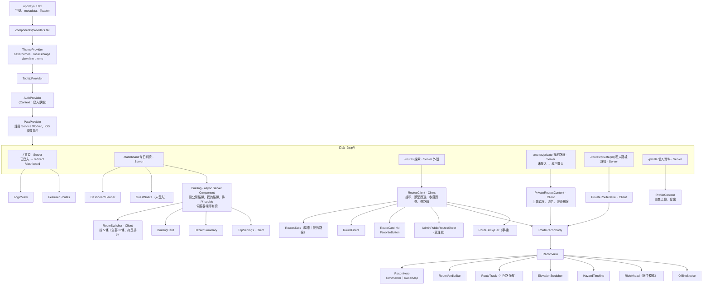

# D3、D4 前端組件架構與狀態

> 依 `strava-route-system/apps/web/src` 實際程式碼整理（main `b7f936d`）；11/9 依 main `c22ad2a`（凍結前 review #95–#103 後）核對。Next.js 16 App Router、React 19、TypeScript、Tailwind＋shadcn/ui。

## 結論

- **全域狀態只有一個：登入**（`AuthContext`）。其他狀態不是「伺服器資料」就是「畫面暫時狀態」，所以不需要 Redux、Zustand 之類的套件。
- **判讀在伺服器算，前端不重算。** 今日判讀頁由 Server Component 直接算好判讀再送 HTML；路線頁由 Custom Hook 打 `/api/routes/briefing` 拿結果，前端只負責顯示與「過期就降級」。伺服器渲染的判讀（今日判讀、首頁精選路線）由用戶端組件 `ExpiryGate` 計時，超過 30 分鐘換成伺服器預先渲染好的過期版本（#98）。
- 公開路線頁與私人路線詳情**共用同一組 Hook 與組件**（`useRouteRecon` → `RouteReconBody`），私人路線只換判讀 API。
- 行程設定（出發時間、運動類型）放網址，自訂均速放 cookie：Server Component 讀得到，第一次渲染就是對的，不會閃。

## D3 組件架構圖



### 狀態放在哪裡

| 狀態 | 放在哪裡 | 實例 | 為什麼放這裡 |
|---|---|---|---|
| 登入狀態、使用者、是否管理員 | **React Context** `AuthContext` | `useAuth()` 的 `user`、`sessionReady`、`isAdmin` | 全站都要知道是否登入；登入時要同時換 Next.js 與 FastAPI 兩份 session |
| 判讀、CCTV、雷達、路線清單、收藏、私人路線 | **Custom Hooks**（元件內 `useState`） | `useRouteBriefing`、`useRouteCCTV`、`useRouteRadar`、`useFavorites`、`usePrivateRoutes` | 都是伺服器資料，各頁需要的不同；放 Hook 讓公開與私人路線共用 |
| 今日判讀的判定結果 | **Server Component** | `components/dashboard/briefing/briefing.tsx` 直接呼叫 `briefLoadedRoute` | 判讀在伺服器算，HTML 送到時就有結果，手機不用等第二次請求 |
| 選中的路線、出發時間、運動類型 | **網址** `?route=&depart=&activity=` | `/routes?route=<slug>&depart=<ISO 時間>&activity=<類型>` | 可分享、重新整理不會掉；Server Component 讀得到 |
| 自訂均速 | **cookie** `dawnline-speed` | 「調整速度」面板 | 不放網址（分享連結不帶個人設定），但 Server Component 要讀得到 |
| 未登入時的公開路線排序 | **cookie** `dawnline-public-order` | 訪客拖曳排序 | 同上；登入後改存後端 `route_order` |
| 分頁間帶著走的行程設定 | **sessionStorage** `dawnline:trip` | 從今日判讀切到探索頁保留出發時間 | 只在這個分頁有效，關掉就忘 |
| 上次登入者名牌 | **localStorage** `dawnline-user` | 重新整理時先畫名字與頭像 | Firebase 還原登入要 1–3 秒，先畫避免閃「登入」按鈕 |
| 畫面暫時狀態 | **元件 `useState`** | 搜尋字串、篩選、抽屜開關、游標里程 | 只有這個元件用得到 |
| 離線快照 | **Service Worker Cache API** | 判讀、路線、鏡頭清單；私人路線另一個 cache | 離線還能顯示；登出時刪私人 cache（見 [D7](tech-highlight.md)） |

## D4 Context／Hooks／Custom Hooks

### Context：`AuthContext`（`src/contexts/AuthContext.tsx`）

| 提供 | 用途 |
|---|---|
| `user`、`loading` | Firebase 登入狀態（`onAuthStateChanged`） |
| `sessionReady` | Next.js session cookie 與 FastAPI `rc_session` 都換完（不論成敗）；需要後端的 Hook 等它才發請求 |
| `isAdmin` | 顯示「管理公開路線」入口（後端另外驗證，前端只決定顯示） |
| `signIn`、`signOut` | 登入：同一個 ID token 換兩份 session；登出：兩份都清，並刪掉私人路線的 SW cache |
| `cachedProfile` | `localStorage` 裡上次登入者的名字與頭像 |

只有登入放 Context。判讀、收藏如果放 Context，任何一筆更新都會讓整棵樹重新渲染，而且大多數頁面根本用不到。

### Custom Hooks（`src/hooks/`）

| Hook | 用途 | 用在 |
|---|---|---|
| `useRouteRecon` | **組合 Hook**：把 CCTV、雷達、折線、途中里程、判讀包成一份，給偵察畫面用 | 探索頁、私人路線詳情 |
| `useRouteBriefing` | 單一路線判讀；換路線清空、離線沿用快照、回前景重抓、過期降級 | `useRouteRecon` |
| `useRouteStatuses` | 路線清單每張卡片的判讀標籤 | 探索頁清單 |
| `useRouteCCTV` | 沿線鏡頭清單 | `useRouteRecon` |
| `useRouteRadar` | 雷達回波回放（只顯示，不進判讀） | `useRouteRecon` |
| `useReconPosition` | 偵察畫面游標里程、目前鏡頭、展開的示警路段 | `ReconView` |
| `usePositionOnRoute` | 途中模式：GPS → 路線里程，移動 0.5 km 或滿 5 分鐘才重判 | `RouteReconBody` → `RideAhead` |
| `useRoutesFromStorage` | 公開路線清單 | 探索頁 |
| `useFavorites` | 收藏：登入後讀一次，星號樂觀更新，失敗改回 | 探索頁、私人路線詳情 |
| `usePrivateRoutes`、`usePrivateRoute` | 私人路線列表／詳情、上傳、改名、刪除 | 我的路線 |
| `useSessionRetry` | 後端回 401 時重新換 session 再試一次 | 私人路線、收藏 |

> `useFirestore.ts` 是早期留下的空殼（只有 TODO），目前沒有任何地方使用。

### 用到的 React 技巧（實例）

**1. `useEffect` 的清除與 `cancelled` 旗標：避免舊請求蓋掉新路線**

使用者快速切換 A → B 路線時，A 的判讀可能比 B 晚回來。`useRouteBriefing`、`useRouteCCTV`、`useRouteRadar`、`useRouteStatuses`、`useFavorites` 都用同一個寫法：

```ts
useEffect(() => {
  let cancelled = false;
  fetch(url).then((res) => {
    if (!cancelled) setState(/* ... */);   // 已經換路線就丟掉
  });
  return () => { cancelled = true; };       // 依賴改變或卸載時執行
}, [routeId, depart, activity, speed, fromKm, refreshAt, endpoint, reload]);
```

`useFavorites` 更進一步：同一條路線連按星號時，每次操作記一個序號（`useRef(new Map())`），失敗回滾前先確認自己還是最後一次操作，舊請求失敗不會把新狀態改回去。

**2. `useRef` 存最新狀態：避免事件監聽重綁**

`useRouteBriefing` 回前景要讀「現在的判讀是不是太舊」。如果把 `state` 放進 effect 依賴，每次狀態一變就要拆掉再綁一次 `visibilitychange`。改成：

```ts
const stateRef = useRef(state);
stateRef.current = state;              // 每次渲染更新

useEffect(() => {
  const onReturn = () => {
    const { loading, error, dataAt } = stateRef.current;   // 讀最新值
    if (error || Date.now() - dataAt >= REFRESH_ON_RETURN_MS) setReload((n) => n + 1);
  };
  document.addEventListener("visibilitychange", onReturn);
  window.addEventListener("pageshow", onReturn);           // bfcache 還原
  return () => { /* removeEventListener ×2 */ };
}, [routeId]);                                              // 只隨路線重綁
```

`usePositionOnRoute` 用同樣方式存 `onKm` callback 與 `routeId`，`watchPosition` 不必因為父元件重新渲染而重開。

**3. `visibilitychange` 回前景重抓，不做持續輪詢**

手機鎖屏或切到別的 App 時計時器會被節流。回到前景時先更新「現在時間」，判讀超過 10 分鐘或上次失敗就重抓一次；頁面一直在前景時，在 30 分鐘過期前 1 分鐘先重抓，避免畫面先閃成未判定。不做每 N 秒輪詢，省電也省 CWA／TDX 額度。

**4. `useCallback`／`useMemo` 的使用時機**

只在兩種情況用：

- **結果要當其他 Hook 的依賴或傳給子元件**：`useRouteRecon` 的 `setAheadKm` 用 `useCallback`，它被當成 `onKm` 傳進 `usePositionOnRoute`，沒有包的話每次渲染都是新函式，定位的 effect 會一直重跑。
- **計算本身昂貴**：`buildRoutePolylineKm(route)`（整條軌跡算累積里程）、`buildCctvMarkers`（每支鏡頭對整條 polyline 做投影）用 `useMemo`，只在 `route` 改變時重算。

一般的小計算（字串組合、篩選幾十筆路線）不包，包了反而多一層比較。

**5. 組合 Hook 讓公開與私人路線共用畫面**

`useRouteRecon(route, trip, endpoint)` 只多一個 `endpoint` 參數：公開路線打 `/api/routes/briefing`，私人路線打 `/api/routes/private/briefing`。`RouteReconBody` 與底下十幾個組件完全不知道路線是公開還是私人。

### 為什麼沒有用 Redux 等狀態管理套件

1. **全域狀態只有登入**，一個 Context 就夠。
2. 其他都是**伺服器資料**：判讀有 15 分鐘的新鮮度、30 分鐘的過期規則、離線快照，這些規則跟著資料來源寫在各自的 Hook 裡比放進全域 store 清楚。
3. **能放伺服器的就放伺服器**：今日判讀用 Server Component 直接算，行程設定放網址與 cookie，前端需要同步的狀態本來就很少。
4. 少一個套件就少一份 bundle 與學習成本。
